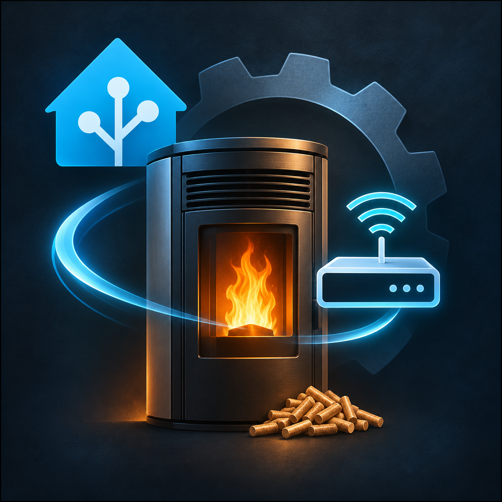

# Navel Gateway

<p align="center"><a href="https://alqedo.com"></a></p>

Built and maintained by **[Alqedo](https://alqedo.com)**.

Local Wi-Fi connectivity for Micronova Navel 2.0 pellet stoves in Home Assistant. One gateway connects up to 16 stoves without a separate Mosquitto installation or manual MQTT credentials.

Navel Gateway provides the connection and per-stove EEPROM write protection. [Agua IOT](https://github.com/vincentwolsink/home_assistant_micronova_agua_iot) provides the stove controls, register maps and entities.

**Development preview:** requires a companion-enabled Agua IOT build implementing gateway API version 2. The integration work is tracked in [Agua IOT PR #320](https://github.com/vincentwolsink/home_assistant_micronova_agua_iot/pull/320); the currently published Agua IOT release must not be assumed compatible. This repository alone is not a complete stove integration.

## Requirements

- Home Assistant 2026.10.4 or newer; OS and Container installations are supported.
- A compatible Navel 2.0 stove and companion-enabled Agua IOT with cached device metadata from an initial cloud connection.
- Stable LAN addresses for Home Assistant and each stove.
- Ability to redirect the stove's vendor hostname through your router or DNS service.
- TCP port 1883 available on Home Assistant. Container users must expose it to the LAN or use host networking.

## Installation

1. Add `https://github.com/Alqedo/navel-gateway` to HACS as a custom **Integration** repository, install it, and restart Home Assistant. Alternatively, copy `custom_components/navel_gateway` into your HA configuration's `custom_components` directory.
2. Open **Settings → Devices & services → Add integration → Navel Gateway**.
3. Select your stoves and enter their LAN addresses. If a stove's cloud ID is not its Wi-Fi MAC, enter the MAC from your router's device list too.
4. Redirect the vendor hostname, for example `remote.mcz.it`, to Home Assistant's LAN address. Keep an existing redirect if it already points there.
5. Select **Local Wi-Fi** in Agua IOT options. Setup checks for a fresh reading from each stove.

Router configuration is manual. The gateway does not change your network or switch on a stove. Local Wi-Fi applies to the entire Agua IOT account entry; all stoves in that entry need a configured local connection. Users with an existing MQTT broker can use Agua IOT's external-broker path instead.

If migrating from an older embedded endpoint, back up your HA configuration and update both integrations together. Two services cannot listen on port 1883 simultaneously. Do not reset an existing write history to bypass its limits.

## Everyday use

Each stove has a connection sensor and an EEPROM protection sensor. Open **Configure** to manage stove addresses or adjust write protection separately for each stove.

The interface supports English, German, French, Dutch and Portuguese. Integration icons are bundled locally, including a high-resolution gateway icon.

## Write protection

EEPROM writes, offsets `>= 32768`, are limited to 15 operations per rolling hour and 50 per rolling day by default. You can lower either limit or block EEPROM writes entirely. One command counts as one operation even when it contains several registers. Reads and RAM writes do not consume the budget.

Budgets are shared across application clients but isolated per stove. They are persisted and verified before forwarding. Unreadable history prevents startup; storage failures block EEPROM writes. Failed or uncertain sends retain their reservation. Agua IOT's own limits also apply; the stricter limit wins.

A positive gateway receipt confirms forwarding, not execution by the stove. Commands are never automatically replayed. These limits reduce write frequency; they do not establish the EEPROM's physical endurance.

## Troubleshooting

- **No stoves listed:** complete Agua IOT setup and check that its build supports gateway API version 2.
- **Port already used:** use your existing broker through Agua IOT or resolve the conflict before enabling the gateway.
- **Disconnected stove:** check its address, MAC, DNS redirect and access to TCP 1883. Reconnection can take time after a restart.
- **Connected but no readings:** check Agua IOT compatibility and its cached device metadata. An MQTT connection alone does not prove application authentication.
- **Write blocked:** inspect the protection sensor and the per-stove settings. Do not delete stored budgets to clear a limit.

## Security and verification

The endpoint is for a trusted LAN, with no internet port forwarding. Stove sessions are restricted by source IP and MAC client ID; these are not cryptographic device authentication. Application clients use generated per-stove credentials over loopback. See [SECURITY.md](SECURITY.md) for boundaries and reporting.

Automated tests cover protocol validation, multi-stove isolation, setup, persistence failures, write limits, translations and HA branding. A single physical stove has been tested for live readings and reconnection. Physical write execution, broader firmware compatibility and a published HACS release remain unverified.

## Development

Use Python 3.14:

```sh
python -m venv .venv
. .venv/bin/activate
pip install -r requirements-dev.txt
ruff check .
ruff format --check .
pytest -q
```

Tests use simulated devices and loopback sockets. Use Conventional Commit messages such as `fix: preserve stove connection after reload`. Include regression tests for protocol or safety changes; never include credentials, raw Identity messages or HA storage dumps in reports.

## Maintainer

Navel Gateway is an open-source project by [Alqedo](https://alqedo.com). Visit our website to learn more about the company. For integration support and bug reports, use [GitHub Issues](https://github.com/Alqedo/navel-gateway/issues).

## License

[MIT](LICENSE). Independent community project, not affiliated with Micronova or stove manufacturers.
